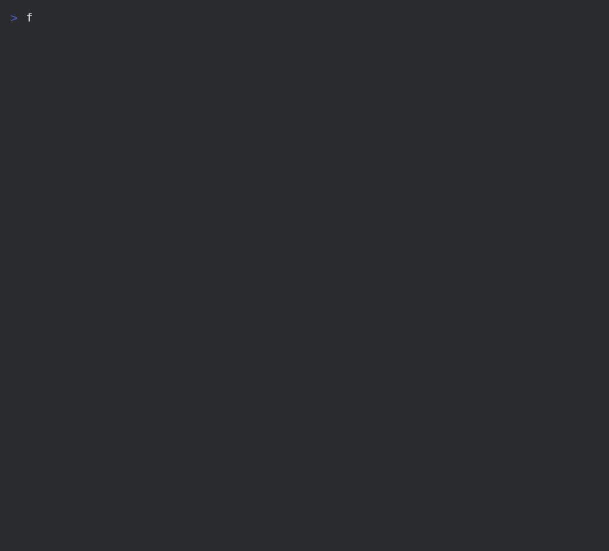

# frappe-cli

[](https://pypi.org/project/frappe-cli/)
[](https://pypi.org/project/frappe-cli/)
[](LICENSE)
[](#development)

```
  ███████╗██████╗  █████╗ ██████╗ ██████╗ ███████╗     ██████╗██╗     ██╗
  ██╔════╝██╔══██╗██╔══██╗██╔══██╗██╔══██╗██╔════╝    ██╔════╝██║     ██║
  █████╗  ██████╔╝███████║██████╔╝██████╔╝█████╗      ██║     ██║     ██║
  ██╔══╝  ██╔══██╗██╔══██║██╔═══╝ ██╔═══╝ ██╔══╝      ██║     ██║     ██║
  ██║     ██║  ██║██║  ██║██║     ██║     ███████╗    ╚██████╗███████╗██║
  ╚═╝     ╚═╝  ╚═╝╚═╝  ╚═╝╚═╝     ╚═╝     ╚══════╝     ╚═════╝╚══════╝╚═╝

                     Frappe CLI  ·  fp  ·  v1.0.4
           Install · Operate · Develop — all in one command
```



**A production-ready CLI that installs and operates [Frappe](https://frappeframework.com/) / [ERPNext](https://erpnext.com/) — from a bare VPS to a working HTTPS site in one command. Also your daily `bench` shortcut.**

Built with Python + [Click](https://click.palletsprojects.com/) + [Rich](https://rich.readthedocs.io/). Every step is independently runnable, self-healing, and idempotent — safe to re-run on partially-installed servers.

---

## Guided setup

```bash
fp                            # show command help
fp setup                      # searchable task menu
fp setup --task production    # complete production deployment
fp setup --task development   # prepare a development bench and site
fp setup --resume             # resume the saved plan
```

The menu also offers site creation, app installation, general HTTPS, inspection,
and custom component selection. Prompts support typing to search, arrow keys,
Enter, and Ctrl+C. Multi-selection uses Tab. Review the detected owner, bench
location, domain, and component plan before applying it; choose **Back: edit
configuration** to revise inputs. Passwords are collected after plan review and
are never saved.

For a new bench, browse the server's folders with the arrow keys and Enter,
or choose **Enter a path** for Tab completion. Select **Use this directory**
to choose the parent folder, then enter the bench name. The wizard checks write
access and shows the full destination before installation.

```bash
fp setup --task production --dry-run
fp setup --task custom --components redis,nodejs --dry-run
fp inspect
```

Custom plans include required dependencies in execution order. OS upgrades and
passwordless sudo are optional, rather than implicit prerequisites. In redirected
input, pass `--task` and `--components` for custom plans; prompts use plain text
and execution emits a stable line-by-line log without animation.

Preview mode executes no installation commands and does not overwrite saved
progress. Failures preserve progress from the first step, explain known problems,
and offer retry/details/exit in a terminal. Temporary package/network failures
receive bounded retries for eligible operations. Resume rechecks observable saved
resources and stops if a previously created bench or site has disappeared.
Interrupted bench directories are archived before a new initialization; failed
wizard runs preserve files for inspection.

Development setup prepares a bench and site and optionally downloads an app.
Run `fp start` from that bench, then `fp add APP` in another terminal to install
the downloaded app. It does not configure production services or HTTPS.

## Two tools in one

```
┌─────────────────────────────────────────────────────────────────────┐
│                          fp  (frappe-cli)                           │
├──────────────────────────────┬──────────────────────────────────────┤
│   🏗  INSTALLER / OPS        │   ⚡  DAILY DEV WORKFLOW             │
│                              │                                      │
│  fp setup           │  fp use [site]     ← set context     │
│  fp step <name>              │  fp migrate        ← auto --site     │
│  fp ssl setup/list           │  fp console                          │
│  fp service status           │  fp restart                          │
│  fp backup setup             │  fp build / watch                    │
│  fp firewall setup           │  fp get-app <url>                    │
│                              │  fp sites / fp context               │
└──────────────────────────────┴──────────────────────────────────────┘
```

---

## Highlights

- **One-command bootstrap:** `fp setup` provisions a fresh Ubuntu VPS end-to-end (MariaDB → Redis → Node → bench → site → ERPNext → nginx → supervisor → SSL).
- **Direct setup commands:** `fp deps`, `fp node`, `fp init`, `fp new`, `fp prod`, and `fp ssl` share operations with the wizard.
- **Context-aware dev workflow:** `fp use` opens an interactive site picker (or pass an exact name in scripts) — remembers your active bench + site, then every `bench` command becomes one word.
- **Multi-bench friendly:** works on fresh and non-fresh VPS — auto-detects existing bench installs and directories.
- **Self-healing:** automatically repairs the supervisor symlink that vanilla `bench setup production` sometimes misses on multi-bench hosts.
- **Hard verification:** polls `supervisorctl status` for RUNNING and pings bench Redis for PONG before declaring success.
- **Resumable:** the wizard saves progress; if a step fails you can fix and `fp setup --resume`.
- **Operator-friendly utilities:** `fp ssl list/setup`, `fp service status`, `fp backup setup`, `fp firewall setup`, and more.

---

## Installation

`frappe-cli` is published on PyPI: <https://pypi.org/project/frappe-cli/>.

> After install, use **`fp`** as your command everywhere (short for Frappe Platform; the per-bench context file is `.fp.yaml`).

### With [uv](https://docs.astral.sh/uv/) (recommended)

```bash
# Install uv (if you don't have it yet)
curl -LsSf https://astral.sh/uv/install.sh | sh

# Install frappe-cli globally
uv tool install frappe-cli

# Verify
fp --version
fp --help
```

To upgrade later:

```bash
uv tool upgrade frappe-cli
```

### With pip

```bash
pip install --user frappe-cli
export PATH="$HOME/.local/bin:$PATH"
fp --help
```

### With pipx

```bash
pipx install frappe-cli
fp --help
```

### Requirements

| Requirement | Version |
|---|---|
| Python | ≥ 3.10 |
| OS | Ubuntu 22.04 or 24.04 (other Debian variants work, others untested) |
| User | A non-root user with `sudo` access |

> **Note:** `frappe-cli` will install Node.js, MariaDB, Redis, nginx, supervisor, wkhtmltopdf, certbot, and `uv` for you. You do not need to pre-install them.

---

## Quick start: bootstrap a fresh VPS

The fastest path from a clean Ubuntu server to a working HTTPS Frappe site:

```
Fresh Ubuntu VPS
      │
      ▼
  apt install python3-pip curl
      │
      ▼
  uv tool install frappe-cli
      │
      ▼
  fp setup          ← interactive prompts, ~30-60 min
      │
      ├─ system-update
      ├─ system-deps
      ├─ nodejs
      ├─ mariadb-install + mariadb-secure
      ├─ redis
      ├─ wkhtmltopdf
      ├─ bench-install + bench-init
      ├─ site-create
      ├─ get-app + install-app
      ├─ production (nginx + supervisor)
      └─ ssl (Let's Encrypt)
            │
            ▼
  ✓ https://erp.example.com  ← live in one command
```

```bash
sudo apt update && sudo apt install -y python3-pip curl

# 1. Install frappe-cli
curl -LsSf https://astral.sh/uv/install.sh | sh
uv tool install frappe-cli

# 2. Run the interactive wizard (≈30–60 min depending on the host)
fp setup
```

You'll be prompted for:

| Prompt | Example |
|---|---|
| Bench directory | `my-bench` |
| Site (FQDN, must resolve to this host) | `erp.example.com` |
| Frappe branch | `version-15` |
| App GitHub URL | `https://github.com/myorg/vsd_fleet_ms` (or blank) |
| App branch | auto-detected — see note below |
| MariaDB root password | (entered **twice** for confirmation) |
| Site Administrator password | (new password) |
| Let's Encrypt email | `you@example.com` |
| Sudo password | (your login password) |
| Allow passwordless `fp r`? | Optional; disabled by default |

#### App branch auto-detection

The wizard detects the right branch automatically:

| App type | Default branch | How it works |
|---|---|---|
| Official Frappe app (`erpnext`, `hrms`, `payments`, …) | Same as Frappe branch (`version-15`) | No network call — detected by name/URL |
| Custom / third-party app | Detected from remote heads | `git ls-remote` checks for `version-15` → `main` → `develop` in priority order |
| Custom / private repo (auth fails) | `main` | Falls back safely; shows a hint to set up SSH keys or Git credentials |

For **private repos**, use the SSH URL format before running the wizard:
```bash
# Make sure your SSH key is added to GitHub first
git@github.com:myorg/vsd_fleet_ms.git   ← use this style in the URL prompt
```

#### MariaDB root password

The wizard asks for this password **twice**. Unlike the site admin password (which can be reset with `bench set-admin-password`), the MariaDB root password is harder to recover if entered incorrectly. Confirm carefully.

If a step fails, fix the issue and resume from where it stopped:

```bash
fp setup --resume
```

When it's done:

```bash
curl -I https://erp.example.com   # HTTP/2 200, served by nginx, valid Let's Encrypt cert
```

---

## ⚡ Daily dev workflow

This is where `fp` really shines. Instead of typing `bench --site <long.site.name> migrate` every time, you set your context once and then use short commands.

```
  ~/my-bench/                    ← bench root
  ├── apps/
  │   ├── frappe/
  │   └── my_custom_app/         ← you are here, deep in code
  ├── sites/
  │   ├── dev.local/
  │   └── staging.example.com/
  └── .fp.yaml                   ← fp writes: site: dev.local
```

### Step 1 — select your active site (saved per bench)

Works from any directory inside the bench — bench root, `apps/`, `apps/my_app/`, etc.

```bash
cd ~/my-bench
fp use dev.local
# ✓ Active site set to dev.local  (bench: my-bench)
```

### Step 2 — run bench commands without the boilerplate

```bash
# Before fp:
bench --site dev.local migrate
bench --site dev.local console
bench --site dev.local clear-cache

# With fp:
fp m
fp c
fp cc
```

### Switching between sites

You never "lose" a site — just `use` a different one. The old site is still there.

```bash
fp use
# ↑↓ move · type to filter · Enter select
#   ● alpha.local
#     beta.local
#     staging.example.com
# ✓ Active site set to staging.example.com

fp m                  → bench --site staging.example.com migrate
```

For scripts or non-interactive shells, pass the exact name:

```bash
fp use staging.example.com
```

### One-command deploy

The most common prod/demo workflow — pull, migrate, then restart:

```bash
cd ~/my-bench/apps/my_custom_app
fp deploy
# → git pull
# → bench --site dev.local migrate
# → bench restart
# ✓ Deploy complete
```

Migrate runs **before** restart so schema and code changes apply cleanly.
Skip `git pull` when you only need migrate + restart:

```bash
fp deploy --no-pull
```

### Make fp restart passwordless

On production benches `bench restart` (and therefore `fp restart` / `fp deploy`) uses `sudo supervisorctl` — which prompts for a password.

Enable passwordless restart in two ways:

**Option A — during `fp setup`** (recommended for new servers):

The wizard asks you at setup time:

```
Allow passwordless 'fp restart' for this user? [Y/n]
```

Answer `Y` and the wizard writes a safe sudoers drop-in automatically.

**Option B — at any time with `fp sudo`:**

```bash
fp sudo status              # check current state
fp sudo enable-restart      # grant passwordless supervisorctl (asks sudo once)
fp sudo disable-restart     # revoke the rule
```

After enabling, `fp deploy` runs completely without password prompts:

```
→ git pull
→ migrate dev.local
→ restart bench
✓ Deploy complete
```

The sudoers rule is scoped to **one user + one binary** (`/usr/bin/supervisorctl`) — minimal privilege. The file is tagged so `fp sudo disable-restart` never removes a hand-crafted rule.

### Daily commands

| Command | Action |
|---|---|
| `fp use [SITE]` | Search/select a site, or save an exact name |
| `fp m` | Migrate the selected site |
| `fp r` | Restart bench processes |
| `fp c` / `fp db` | Python / database console |
| `fp get APP` | Download an app; detect the existing Frappe branch |
| `fp add APP` | Install an available app on the selected site |
| `fp apps` | List installed apps |
| `fp cc` | Clear cache |
| `fp backup [--with-files]` | Back up the selected site |
| `fp restore FILE` | Restore a backup to the selected site |
| `fp execute METHOD` | Execute a site method |
| `fp test --app APP` | Run app tests on the selected site |
| `fp build` / `fp watch` / `fp start` | Build assets / watch changes / start development processes |
| `fp deploy` | Pull the current app repository, migrate the selected site, restart |

Site commands support `--site` / `-s` for a temporary override:

```bash
fp m -s staging.example.com
fp backup -s staging.example.com --with-files
fp m --bench /srv/frappe/demo-bench --site staging.example.com
fp m --dry-run
```

Explicit overrides leave `.fp.yaml` unchanged. The saved selection is shared by
terminals using the same bench; use an explicit site when working concurrently.
Existing full command names such as `fp migrate` and `fp restart` still work.
`fp mariadb` retains its database-console behavior; `fp database` installs the server.

Bench detection walks upward from the current directory looking for `apps/` and
`sites/`. The active site is saved in `<bench>/.fp.yaml`, independently of wizard
progress in `~/.frappe-cli-state.json`.

---

## Command structure

```
fp <group> <command> [options]
```

| Group | What it does |
|---|---|
| `setup` | Searchable task selection, plan review, progress, and resume |
| **`step`** | **Run any individual wizard step on its own** |
| `ssl DOMAIN` | Configure HTTPS for a Frappe site, nginx/Apache website, or local application |
| `site` | Create, list, backup, restore sites |
| `app` | Get / install / update / remove Frappe apps |
| `service` | Restart, status, logs for bench + system services |
| `backup` | Manual + scheduled backups (optionally to an external HD) |
| `firewall` | UFW configuration with secure defaults |
| `maintenance` | Log rotation, etc. |
| `monitor` | Live logs and system health |
| `optimize` | Performance tuning |
| `rollback` | Restore from backup, uninstall site, etc. |
| `config` | YAML config get/set/validate |
| **`use`** | **Set active bench + site context** |
| **`context`** | **Show current bench + active site** |
| **`sites`** | **List sites in the current bench** |

Every command supports `--help`. Direct installation commands support `--dry-run`, `--debug`, and `--force`. Existing grouped command syntax remains supported.

---

## Everyday recipes

### Configure HTTPS for a domain

```bash
fp ssl back.example.com
fp ssl back.example.com --email owner@example.com
fp ssl back.example.com --dry-run

# Application listening on localhost:8000, without an existing virtual host:
fp ssl back.example.com --port 8000 --email owner@example.com

# Existing Frappe bench outside the normal discovery locations:
fp ssl erp.example.com --bench /srv/frappe/production-bench
```

`fp ssl` asks for a domain in a terminal. Automatic detection uses the Frappe
integration for a matching site, or an existing exact nginx/Apache virtual host.
`--port` creates a new nginx proxy to `127.0.0.1:PORT`; it never replaces an existing
virtual host. The domain must resolve to the intended server and the validation
and HTTPS ports must be reachable. Existing unrelated server configurations are
preserved. nginx configuration is tested before reload.

For certificate-only workflows:

```bash
fp ssl example.com --method webroot --webroot /var/www/example --email owner@example.com
fp ssl example.com --method standalone --email owner@example.com
```

These obtain a certificate and configure renewal; you must install that certificate
in your application's TLS configuration. Standalone validation needs port 80 free.
Wildcard/DNS-provider automation is not included. Missing packages are installed
through apt on supported hosts. General web-server renewal uses `certbot.timer`;
Frappe keeps bench's renewal integration. A certificate file alone is insufficient:
web-server setup verifies the certificate and public TLS endpoint before success.

Existing `fp ssl setup --site-name DOMAIN` and `fp ssl list` remain available.
`ssl list` currently lists discovered Frappe sites, rather than every host certificate.

### Run an individual installation operation

```bash
fp prod                       # detect the bench from cwd
fp prod --bench /srv/frappe/production-bench
fp prod --dry-run
fp ssl erp.example.com
```

| Command | Operation |
|---|---|
| `fp os-update` | Update package indexes and upgrade system packages |
| `fp deps` | Install Frappe system dependencies |
| `fp uv` | Ensure uv is installed |
| `fp node` | Install Node.js and Yarn |
| `fp database` | Install/configure MariaDB |
| `fp db-secure` | Secure MariaDB; accepts `FP_MARIADB_PASSWORD` |
| `fp redis` | Install Redis |
| `fp pdf` | Install wkhtmltopdf |
| `fp bench` | Install the bench CLI |
| `fp init NAME [--path PARENT] [--branch BRANCH]` | Initialize a bench |
| `fp new DOMAIN` | Create a site in the selected bench |
| `fp get APP [--branch BRANCH]` | Download an app |
| `fp dns` | Enable DNS multitenancy |
| `fp prod` | Configure production and verify supervisor/Redis |
| `fp sudo enable-restart` | Enable optional passwordless restarts |
| `fp add APP` | Install an app on the selected site |
| `fp reload` | Reread supervisor configuration and reload nginx |
| `fp ssl DOMAIN` | Configure HTTPS |

`fp r` runs `bench restart`. `fp reload` performs the installation pipeline's
supervisor reread/update and nginx reload. `fp service restart` affects host services.

Existing `fp step <name>` commands remain supported; use `fp step list` to inspect
the underlying pipeline.

### Add another site to an existing bench

```bash
cd ~/my-bench
fp new shop.example.com        # asks for credentials; selects the new site
fp add erpnext
fp dns
fp reload
fp ssl shop.example.com
```

You can also choose **Add a site** from `fp setup`. For reproducible scripts, pass
`--bench` explicitly and provide database/admin credentials through
`FP_MARIADB_PASSWORD` and `FP_ADMIN_PASSWORD`, rather than command-line passwords.

### Set up an automated backup

```bash
fp backup setup \
  --bench-name my-bench \
  --site-name erp.example.com \
  --admin-email you@example.com
```

### Service health check

```bash
fp service status --bench-name my-bench --site-name erp.example.com
fp service restart
```

### Firewall (UFW)

```bash
fp firewall setup        # opens 22, 80, 443 by default
```

---

## Tips for non-fresh VPS

`frappe-cli` is designed to work on hosts that already have bench installed or already have other Frappe benches:

- `fp step bench-install` — checks if `bench` is on `PATH` (any of `~/.local/bin`, `/usr/local/bin`, `/usr/bin`) and skips if found.
- `fp step bench-init` — skips if the target bench directory already has `apps/frappe/`.
- `fp step production` — explicitly creates the missing `supervisor.conf` symlink that vanilla `bench setup production` sometimes forgets on multi-bench hosts.
- `fp step ssl` — uses `sudo test -f` so it can correctly detect existing certs in the root-owned `/etc/letsencrypt/live/` directory.

---

## Why `frappe-cli` over raw `bench`?

| Pain point | `bench` alone | `frappe-cli` |
|---|---|---|
| Fresh VPS bootstrap | 8+ manual steps, lots of doc-hopping | `fp setup` |
| Daily `migrate` / `console` | `bench --site long.site.name migrate` | `fp migrate` |
| Multi-bench supervisor symlink | Sometimes silently missing → errors | Auto-created and verified |
| Redis health check before `install-app` | None | TCP `PING`/`PONG` on queue/cache/socketio ports |
| `bench setup lets-encrypt` prompts | Two interactive `[y/N]` prompts | Automated |
| State across reboots / partial failures | Manual | `--resume` from saved state |
| Re-running a single step | Find the command, get the args right | `fp step <name>` |
| Listing sites without SSL | grep + sudo find | `fp ssl list` |

---

## Configuration file utilities

The following YAML illustrates the existing config utilities. Root `--config` loading
is not wired into setup yet; it does not prefill the wizard:

```yaml
# production.yaml
system:
  timezone: "Africa/Nairobi"
  locale: "en_US.UTF-8"
  user: "frappe"
frappe:
  branch: "version-15"
  bench_name: "my-bench"
  site_name: "erp.example.com"
  admin_password: "changeme"
  mariadb_root_password: "changeme"
services:
  enable_ssl: true
  enable_ufw: true
backup:
  admin_email: "you@example.com"
  retention_days: 7
```

See [`src/frappe_cli/data/example_config.yaml`](src/frappe_cli/data/example_config.yaml).

---

## Logs and troubleshooting

- Legacy operations use `/var/log/frappe-installer.log` (with a local fallback). The wizard shows a live log tail or plain output; failures include redacted diagnostics.
- Use `--debug` on installation commands for detailed failure output.
- Use `--dry-run` on `step` / `install` commands to preview what would run.
- For a known-working manual flow you can compare against, see [`docs/superpowers/test3-bench-setup.md`](docs/superpowers/test3-bench-setup.md) — a step-by-step runbook used to verify every wizard step.

---

## Development

```bash
git clone https://github.com/okama12/frappe-cli.git
cd frappe-cli

# Install dependencies
poetry install

# Run all tests (163 passing)
PYTHONPATH=src poetry run pytest tests/

# Lint (ruff + black --check + isort --check + mypy)
poetry run bash scripts/lint.sh

# Install locally and try it
poetry run fp --help
```

### Project layout

```
src/frappe_cli/
├── cli.py                  # root Click group — registers all commands
├── dev/
│   ├── context.py          # bench detection + .fp.yaml read/write
│   └── commands.py         # use, context, sites + passthrough commands
├── install/
│   ├── wizard.py           # fp setup
│   ├── context.py          # InstallContext dataclass
│   ├── state.py            # ~/.frappe-cli-state.json (resume support)
│   └── steps/              # one InstallStep class per wizard step
├── step/                   # fp step <name> — thin wrappers around steps/
├── ssl/                    # fp ssl setup, fp ssl list
├── site/, app/, service/, backup/, firewall/, ...
└── utils/                  # shell, errors, logging, validators
```

Tests live under `tests/` (one file per command group, plus `test_install_steps.py` for the wizard step classes and `test_dev_commands.py` for dev workflow).

---

## Contributing

1. Fork → feature branch.
2. Add or improve a command group / step.
3. Add tests in `tests/` (use `click.testing.CliRunner`).
4. Run `poetry run bash scripts/lint.sh` and `PYTHONPATH=src poetry run pytest`.
5. Open a PR with a clear description.

---

## About

Built by **Rashidi Okama** in Tanzania to make day-to-day Frappe work easier.

- Website: <https://rashidiokama.com>
- GitHub: <https://github.com/okama12>

Run `fp about` for the in-CLI credits panel. If this project saves you time, please [star the repo](https://github.com/okama12/frappe-cli) — it really helps.

---

## License

[MIT](LICENSE) © Rashidi Okama
